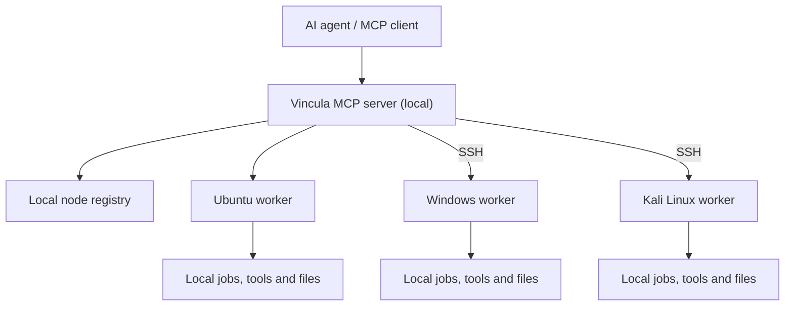

# Vincula

**Distributed execution infrastructure for AI agents and personal computing environments.**

Vincula connects multiple Windows and Linux computers into a shared operational environment. An AI agent can discover enrolled nodes, inspect their resources and available tools, run authorized programs, move files, distribute independent workloads, and recover results after a disconnection.

Vincula is not an AI model or an agent framework. It provides an execution and coordination layer through the Model Context Protocol (MCP), while the connected agent decides how to approach its task. Codex has been used in real-machine acceptance tests; other MCP-compatible clients can integrate through the same interface, subject to their own client compatibility and approval policies.

The project consists of two complementary components:

| Component | Purpose |
| --- | --- |
| **Vincula Core** | Node discovery, authenticated remote execution, persistent jobs, distributed batches, reusable capabilities, file access and recovery. |
| **Vincula Desktop** | Remote desktop, machine status, file transfers, shared mouse, keyboard and clipboard. The existing two-computer workflow is separate from the multi-node desktop backend under development. |

**Current validation:** three physical computers running Ubuntu, Windows and Kali Linux; nine successful origin-to-destination execution checks on November 26, 2026. See the [rollout report](docs/collaudo-rollout-core.md) for the exact test scope and remaining limitations.

## Architecture



This example uses Ubuntu as the controller. Windows and Kali can also originate requests using their own local MCP server and configured routes. Every enrolled computer has a persistent identity (UUID). SSH routes are specific to the originating computer; the registry is not a globally replicated database.

The destination worker executes under its own operating-system account, applies local permissions and records job state and results. Jobs can continue after the controller disconnects. A receiving-only Linux node does not require a local AI model, a running Codex client, a graphical session or an outgoing SSH identity.

Vincula Core uses Python, SQLite, OpenSSH and MCP over standard input/output. The desktop clients use Python/GTK 3 on Ubuntu and C#/WinForms on Windows, with separate remote-display and input-sharing engines.

<a id="vincula-agent-infrastructure"></a>

## Vincula Core

### What an agent can do

| Capability | Interface / documentation |
| --- | --- |
| Discover enrolled nodes and read CPU, memory, OS and availability | `list_nodes`, `get_node_status` — [Node discovery](docs/agent-mcp.md) |
| Execute registered programs or new commands and arguments | `start_job`, `execute_process` — [Jobs](docs/lavori-mcp.md), [native execution](docs/native-process-mcp.md) |
| Read job state, output and exit codes; request cancellation | `read_job`, `read_process`, `stop_job` — [Jobs](docs/lavori-mcp.md) |
| Discover installed commands and maintain catalog-based sessions | `discover_tools`, `open_shell`, `send_shell_command` — [Sessions](docs/sessioni-mcp.md) |
| Browse, read and transfer files within configured roots, including between remote nodes | `list_file_roots`, `request_file`, `transfer_file` — [File access](docs/file-mcp.md) |
| Run independent tasks in parallel on different computers | `submit_batch`, `get_batch` — [Distributed batches](docs/calcolo-distribuito.md) |
| Discover and invoke versioned, parameterized software adapters | `discover_capabilities`, `submit_capability`, `get_capability_run` — [External capabilities](docs/capacita-mcp.md) |
| Recover existing distributed plans and results from another reachable node | [Runtime recovery](docs/recupero-runtime.md) |
| Run a Linux worker independently of desktop login | [Core service](docs/core-service.md) |
| Use an OS-managed outgoing SSH identity on Linux controllers | [Controller identity](docs/controller-identity.md) |
| Add nodes through verified public invitations using the GUI or local JSON CLI | [Node enrollment](docs/node-enrollment.md), [registry](docs/registro-nodi.md) |

The current [MCP server](agent/server.py) exposes 23 tools. Enrollment, service installation and local policy configuration are separate operator-facing functions.

### Example workflow

An agent receives a request to analyze a dataset using the available computers. It discovers nodes, checks the relevant tools and capabilities, chooses the inputs and workload partitions, submits the jobs and collects their results. Vincula provides the execution and transport mechanisms; workload decomposition and semantic interpretation remain the responsibility of the agent or application.

Jobs and plans have stable identifiers. Repeating the same request with the same identifier retrieves or resumes the existing submission rather than blindly creating a new one. Replicated plan manifests allow a different origin to recover existing jobs in read-only mode. This is not automatic coordinator failover or a global exactly-once guarantee.

### Access model and security boundary

Use Vincula only on systems you own or are authorized to administer.

The destination operator chooses the local access policy:

- **Ask:** new jobs require approval on the destination; native process approval is tied to the exact request manifest.
- **Full:** authorized jobs can run without individual confirmation.
- **Native execution:** an independent, explicit opt-in permits new executable/argument combinations without preregistering each command. Existing installations do not gain this permission automatically on update.

Full access with native execution enabled grants substantial control within the worker account's normal OS permissions. It is **not an OS sandbox**, does not automatically elevate privileges, and does not enforce structured file-root grants against arbitrary native programs. Client-side AI approval policies still apply independently.

SSH authentication uses operator-configured routes and verified host keys. Linux controllers can use a dedicated system-managed identity so that the AI client need not handle private keys or interactive passphrases. Private keys are not included in node invitations.

See [native process execution](docs/native-process-mcp.md), [controller identity](docs/controller-identity.md) and [runtime recovery](docs/recupero-runtime.md) for guarantees and limitations.

## Platform support and validation

| Platform | Core | Desktop |
| --- | --- | --- |
| Ubuntu Linux | Controller and worker tested; managed controller identity and Linux service available | Windows Dock (GTK 3) |
| Windows | Controller and worker tested in the normal user context | Linux Dock (WinForms) |
| Kali Linux | Controller and worker tested; receiving service verified after reboot and local disk unlock | No dedicated Kali desktop client qualified |
| macOS | Not currently supported | Not currently supported |

The Windows headless controller is not yet qualified. Kali's new controller identity has been tested without the personal SSH agent or graphical environment variables, but has not yet been revalidated after a fresh reboot. The earlier receiver boot test remains a separate result.

### Three-node execution matrix

The November 26 rollout used actual MCP sessions and executed a new program from each origin on every destination. All nine checks verified the expected log and intentional exit code `7`.

| Origin / destination | Ubuntu | Windows | Kali |
| --- | --- | --- | --- |
| Ubuntu | Pass | Pass | Pass |
| Windows | Pass | Pass | Pass |
| Kali | Pass | Pass | Pass |

Windows passed in an Interactive/Limited user task; the earlier nested-SSH execution attempt timed out. The updated GUI launchers were deployed, but already-open windows were deliberately left running. This is not evidence of a fully qualified multi-node desktop.

- [November 26 rollout report](docs/collaudo-rollout-core.md) and [structured test receipts](docs/collaudi/2026-11-26-rollout-core.json).
- [Headless Kali receiver test](docs/collaudo-core-headless.md): real Windows Codex executed a new program after a Kali reboot and local encrypted-disk unlock, without a graphical user login; Ubuntu recovered the same job.
- [Distributed recovery test](docs/collaudo-recupero-triade.md): batch and capability recovery across three physical machines in isolated QA profiles, preserving original identifiers and pending approvals. Origin unavailability was emulated in this test.
- [Functional CI](https://github.com/Daniele-Cangi/Vincula/actions): Windows and Ubuntu, Python 3.10 and 3.14, runtime tests, MCP smoke tests and desktop source/build checks.

### Distributed computing benchmark

The November 22 benchmark split an identical Python CPU workload across three physical computers. Twelve cases (three repetitions per mode) produced the same canonical result.

| Execution mode | Median compute time | Median end-to-end time |
| --- | ---: | ---: |
| ASUS / Ubuntu | 19.974 s | 20.491 s |
| Lenovo / Windows | 11.144 s | 28.191 s |
| X260 / Kali | 20.427 s | 41.490 s |
| Three-node distributed | 8.799 s | 24.637 s |

Distributed computing reduced the critical compute time, but with inputs initially on Ubuntu it was slower overall than local Ubuntu execution because of transfer and coordination overhead. This is a fixed-partition CPU benchmark, not evidence of pooled RAM/VRAM, general GPU acceleration or universal speedup.

[Benchmark methodology, raw records and reproducible workload](docs/benchmark-cpu-tre-nodi.md).

## Getting started with Core

Prerequisites: a supported Windows or Linux system, Python 3.10 or newer, OpenSSH and access to the intended nodes. The repository contains source code; external components, SSH credentials, host-key pins and node-specific configuration must be prepared locally.

1. Set up key-based SSH access to the destination computers and verify host fingerprints independently. Configure the [node registry](docs/registro-nodi.md) or use [public node invitations](docs/node-enrollment.md).
2. Create a Python environment on the computers that will run MCP or workers.

   Linux:

   ```sh
   python3 -m venv work/vincula-mcp
   work/vincula-mcp/bin/python -m pip install -r agent/requirements.txt
   ```

   Windows (PowerShell):

   ```powershell
   py -3 -m venv work/vincula-mcp
   .\work\vincula-mcp\Scripts\python.exe -m pip install -r agent\requirements.txt
   ```

3. On each destination, use its environment's Python interpreter to run `python agent/jobs.py init`, then prepare and start its worker as described in [authorized jobs](docs/lavori-mcp.md). Choose the access policy locally. Start with `ask` and enable general execution only when you intend to grant that capability.
4. Configure your MCP client to launch the absolute path of the environment's Python interpreter with the absolute path of `agent/server.py` as its argument, using the `stdio` transport. See [MCP setup](docs/agent-mcp.md) for the required environment and SSH configuration.
5. Run `agent/check.py` with the same interpreter to validate node discovery and status. For a boot-managed Linux receiver or a desktop-independent controller, follow the separate [Core service](docs/core-service.md) and [controller identity](docs/controller-identity.md) guides.

## Vincula Desktop

The original two-computer desktop workflow remains available independently of Core.

| Application | Runs on | Source | Guide |
| --- | --- | --- | --- |
| Windows Dock | Ubuntu | [Python / GTK 3](outputs/Windows%20Dock) | [Setup and usage (Italian)](outputs/Windows%20Dock/LEGGIMI.txt) |
| Linux Dock | Windows | [C# / WinForms](outputs/Linux%20Dock) | [Setup and usage (Italian)](outputs/Linux%20Dock/LEGGIMI.txt) |

The applications expose remote status, transfers, script execution, remote desktop and input sharing. Both also include node catalog, invitation and verification interfaces. Importing an invitation registers a node; the separate authenticated check does not by itself establish running-worker or desktop readiness.

The multi-node desktop backend is in development; the existing two-computer desktop workflow and the tested three-node Core execution network are different capabilities.

<a id="appunti-condivisi"></a>

### Shared clipboard

Open **Linux Dock on Windows** to start sharing. Once connected, copy text, move the pointer to the other screen and paste using `Ctrl+V` or the destination application's Paste command. Text clipboard synchronization is bidirectional.

In **Mouse e tastiera** (Mouse and keyboard), change the Ubuntu screen's position even while sharing is active; the session reconnects automatically. Linux Dock remembers layout, clipboard and auto-start preferences. **Disattiva condivisione** (Disable sharing), next to **Desktop remoto**, stops sharing and suspends automatic reconnection until the application is reopened or sharing is manually re-enabled. Use **Trasferimenti** for individual files.

Barrier 2.4 may clear Ubuntu's local clipboard when its session starts, even with clipboard synchronization disabled.

<a id="configurazione"></a>

### Direct Ethernet configuration (existing two-PC desktop workflow)

These are the original example settings for the optional desktop pair, not a requirement for the general Core network. Other enrolled nodes can use their own reachable SSH routes.

1. Assign direct Ethernet addresses, for example `192.168.77.1/24` on Ubuntu and `192.168.77.2/24` on Windows.
2. Configure OpenSSH on both computers with key authentication, and verify the host key fingerprints on the computers themselves. The example uses port `2222` on Ubuntu's cable interface. For Windows Dock, save the verified Windows public host key in `outputs/Windows Dock/host.known_hosts`, in the format `192.168.77.2 ssh-ed25519 <verified public host key>`. The app looks for `~/.ssh/id_ed25519_windows_dock`. Its guide describes environment overrides for addresses and accounts.
3. For Linux Dock, configure the `linux-dock` alias in `%LOCALAPPDATA%\Linux Dock\ssh_config`. Set the Linux address, port, account, authentication key and verified known-hosts file. Use `StrictHostKeyChecking yes`, `BatchMode yes` and `IdentitiesOnly yes`.
4. For remote desktop, configure authenticated VNC servers on loopback port `5909` and install compatible viewers. Windows Dock looks for TigerVNC under `~/.local/share/linux-dock/vnc/bin/`. Linux Dock looks for TightVNC Viewer under `%LOCALAPPDATA%\Linux Dock\vnc-package\PFiles\TightVNC\`. Prepare each local VNC profile with restricted access.
5. For input sharing from Windows, use Deskflow 1.27 in `%LOCALAPPDATA%\Linux Dock\input-engine\deskflow-1.27.0-win-x64-portable`. On Ubuntu/X11, install Barrier 2.4 and place its client at `~/.local/share/linux-dock/vnc/bin/barrierc`. Install [receive-input.sh](outputs/Linux%20Dock/receive-input.sh) as an executable at `~/.local/share/linux-dock/vnc/receive-input`. Configure Deskflow and Barrier TLS profiles with mutually verified fingerprints. Deskflow listens on `127.0.0.1:24800`; reverse SSH forwarding exposes port `24801` on Ubuntu loopback.
6. On Wayland, use Deskflow with libportal 0.10 or later for mouse, keyboard and text clipboard sharing, and grant clipboard access in GNOME. The application guides describe the receiver and Ubuntu-primary configuration. Remote desktop from Windows to Ubuntu uses the X11 VNC server.

<a id="avvio-dai-sorgenti"></a>

### Launch Desktop from source

On Ubuntu, install Python 3, GTK 3 and the OpenSSH client, then run from the repository root:

```sh
./"outputs/Windows Dock/windows-dock.py"
```

On Windows, run from the repository root using **Windows PowerShell 5.1**:

```powershell
$dest = Join-Path $env:LOCALAPPDATA 'Linux Dock'
[void][IO.Directory]::CreateDirectory($dest)
$source = [IO.File]::ReadAllText((Resolve-Path 'outputs/Linux Dock/LinuxDock.cs').Path)
Add-Type -TypeDefinition $source -OutputType WindowsApplication `
  -ReferencedAssemblies 'System.dll','System.Core.dll','System.Drawing.dll','System.Windows.Forms.dll','System.Web.Extensions.dll' `
  -OutputAssembly (Join-Path $dest 'Linux Dock.exe')
Copy-Item 'outputs/Linux Dock/linux-dock.ico' $dest
Copy-Item 'outputs/Linux Dock/linux-dock-icon.png' $dest
& (Join-Path $dest 'Linux Dock.exe')
```

## Roadmap and known limitations

The [multi-node infrastructure plan](docs/piano-infrastruttura-multinodo.md) tracks remaining work, including:

- Complete automated node enrollment and initial authorization; migrate remaining legacy routes to the explicit node verification flow.
- Qualify a Windows headless controller and revalidate Kali's managed controller after a fresh boot.
- Complete multi-node desktop transport, TLS trust, provisioning, graphical consent and real-engine integration ([desktop backend](docs/desktop-backend.md)).
- Improve resource-aware scheduling, concurrency and large-file transfers.
- Extend workload and failure testing, including the limits of cross-origin recovery.

Vincula does not currently provide an integrated LLM, pooled hardware memory, transparent distributed GPU training, automatic coordinator election or a globally consistent execution guarantee. A connected agent can build higher-level workflows on top of the infrastructure.

## Development

Run the runtime test suite with the project's Python environment:

```sh
python -W error::DeprecationWarning -W error::ResourceWarning -m unittest discover -s agent -p 'test_*.py' -v
```

See the [CI workflow directory](.github/workflows) and [functional test runs](https://github.com/Daniele-Cangi/Vincula/actions). Tests involving actual computers, credentials, display servers or external engines require the corresponding local setup.

## Documentation

Most detailed setup and validation guides are currently written in Italian; this English README provides the project overview.

| Area | Guide |
| --- | --- |
| MCP setup | [Discovery and status](docs/agent-mcp.md) |
| Node configuration | [Registry](docs/registro-nodi.md) · [Enrollment](docs/node-enrollment.md) |
| Workloads | [Jobs](docs/lavori-mcp.md) · [Native processes](docs/native-process-mcp.md) · [Sessions](docs/sessioni-mcp.md) |
| Data and capabilities | [Files](docs/file-mcp.md) · [Capabilities](docs/capacita-mcp.md) · [Batches](docs/calcolo-distribuito.md) |
| Reliability | [Runtime recovery](docs/recupero-runtime.md) · [Core service](docs/core-service.md) · [Controller identity](docs/controller-identity.md) |
| Desktop | [Catalog](docs/catalogo-gui.md) · [Coordinator](docs/desktop-coordinator.md) · [Backend](docs/desktop-backend.md) |
| Project status | [Roadmap](docs/piano-infrastruttura-multinodo.md) · [Rollout](docs/collaudo-rollout-core.md) · [CPU benchmark](docs/benchmark-cpu-tre-nodi.md) |

<a id="componenti-esterni"></a>

## External components

Deskflow, Barrier, TigerVNC, TightVNC, x11vnc, OpenSSH and x2vnc are installed separately. The [x2vnc patch](outputs/Windows%20Dock/x2vnc-no-clipboard.patch) applies to x2vnc 1.7.2. The [included GPL text](outputs/Windows%20Dock/x2vnc-COPYING.txt) comes from the x2vnc distribution. The [GNOME 50 clipboard patch](outputs/Windows%20Dock/deskflow-gnome50-clipboard.patch) applies to Deskflow 1.27.0 under Deskflow's license.

<a id="licenza"></a>

## License

Original Vincula code is distributed under the [GNU General Public License v3.0 or later](LICENSE) (`GPL-3.0-or-later`).

The x2vnc patch retains `GPL-2.0-or-later`. Its [license text](outputs/Windows%20Dock/x2vnc-COPYING.txt) is included alongside the patch.
